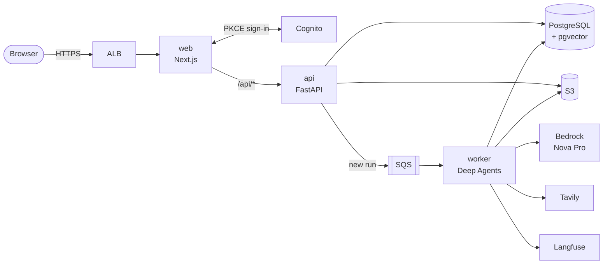

# Deep Research Agent

[](https://github.com/sagar-spkt/DeepResearchAgent/actions/workflows/repository-checks.yml)
[](https://github.com/sagar-spkt/DeepResearchAgent/actions/workflows/application-checks.yml)
[](https://github.com/sagar-spkt/DeepResearchAgent/actions/workflows/infrastructure-checks.yml)
[](LICENSE)

A self-hosted, multi-user research assistant. Ask a question and an agent
searches the web and your own documents, reads the sources, and writes a report
with citations. Conversations, uploaded documents and saved memory are private
to each user and persist between sessions.

The agent is built on the open-source [Deep Agents SDK](https://github.com/langchain-ai/deepagents)
and runs on Amazon Bedrock. Staging and production run on AWS and are created
and destroyed entirely from GitHub Actions.

## Features

- **Web and document research.** The agent combines Tavily web search, page
  reading and retrieval over your uploaded files, and can delegate subtopics to
  sub-agents. Reports are Markdown with linked sources.
- **Private document library.** Upload PDF, DOCX, TXT or Markdown files and
  attach them to a conversation. Documents are chunked and indexed with hybrid
  retrieval: BGE embeddings in pgvector plus keyword search.
- **Durable conversations.** Runs execute in a background worker, stream
  progress to the browser, survive page reloads, and resume from a Postgres
  checkpoint if the worker restarts. Runs can be cancelled.
- **Explicit memory.** Users can save facts the agent should remember across
  conversations. Nothing is saved without the user asking for it.
- **Accounts and approval.** Sign-up via Amazon Cognito. New accounts stay
  pending until an admin approves them; owners manage roles. All ownership and
  role checks happen on the server.
- **Tracing and cost tracking.** Every model and tool call is recorded in
  self-hosted [Langfuse](https://langfuse.com) with inputs, outputs, token
  usage and dollar cost.

## Architecture



| Component | Responsibility |
| --- | --- |
| `web/` | Next.js UI. Handles Cognito sign-in and keeps the session in an encrypted HttpOnly cookie. Proxies `/api/*` to the API so the browser never holds API tokens. |
| `backend/research_app/api.py` | FastAPI service. Verifies tokens, enforces ownership and approval, stores uploads, queues runs and streams run events over SSE. |
| `backend/research_app/worker.py` | Leases queued runs, runs the research agent with a 15-minute limit, and indexes uploaded documents. |
| `backend/research_app/research.py` | Agent definition: tools (`retrieve_documents`, `web_search`, `read_webpage`), sub-agents, memory and Langfuse callbacks. |
| `helm/research`, `helm/observability` | Kubernetes charts for the application and the Langfuse stack (web, worker, ClickHouse, Valkey). |
| `infra/aws` | Terraform for one environment: VPC, EKS, RDS, S3, SQS, ECR, Cognito, ACM, Route 53 and IAM. |

Design decisions are recorded as ADRs in [`docs/decisions`](docs/decisions/).
[ADR-0012](docs/decisions/0012-simple-github-actions-environments.md) explains
the deployment model.

## Tech stack

| Layer | Technology |
| --- | --- |
| Agent | Deep Agents SDK 0.7, LangGraph Postgres checkpoints |
| Models | Amazon Bedrock: Nova Pro in AWS, Nova Lite for local development |
| Backend | Python 3.12, FastAPI, SQLAlchemy, uv |
| Frontend | Next.js 16, React 19, assistant-ui |
| Data | PostgreSQL 16 with pgvector, S3, SQS |
| Embeddings | BAAI/bge-small-en-v1.5, running on CPU |
| Platform | EKS, Helm, Terraform, AWS Load Balancer Controller |
| Observability | Langfuse v3 (self-hosted) |
| CI/CD | GitHub Actions with OIDC (no long-lived AWS keys) |

## Getting started

### Prerequisites

- Python 3.12 and [uv](https://docs.astral.sh/uv/) 0.12.5
- Node.js 22+
- Docker (for PostgreSQL and the optional Langfuse stack)
- An AWS profile with access to Bedrock Nova Lite in `us-east-1`
- A [Tavily](https://tavily.com) API key for web search (optional)

### Run locally

```sh
# Backend dependencies and the embedding model
uv sync --locked --extra bedrock --extra local-postgres --extra embeddings --group dev --group build
scripts/download_embedding_model.sh

# Local configuration (both files are git-ignored)
cp .env.example .env
cp web/.env.example web/.env.local

# Database
set -a; source .env; set +a
PYTHONPATH=backend .venv/bin/python -m research_app.manage migrate

# API and worker, in separate terminals
PYTHONPATH=backend .venv/bin/python -m uvicorn research_app.main:app --port 8000
PYTHONPATH=backend .venv/bin/python -m research_app.worker

# Web UI
npm --prefix web ci
npm --prefix web run dev
```

Open <http://localhost:3000>. Locally you are signed in as the bootstrap owner
`demo@example.test`; Cognito is used only in AWS.

The default configuration uses SQLite and local file storage. For PostgreSQL,
Docker Compose, and local Langfuse, see
[docs/local-development.md](docs/local-development.md).

> [!NOTE]
> Local runs call Bedrock and Tavily and are billed per use. Set
> `MODEL_PROVIDER=fake` only for offline tests; it returns synthetic reports.

## Testing

```sh
# Repository checks (standard library only)
python3 scripts/check_repository.py
python3 -m unittest discover -s tests -v

# Backend
.venv/bin/ruff check backend scripts tests
.venv/bin/mypy backend/research_app --no-incremental
.venv/bin/python -m pytest backend/tests -q

# Frontend
node --test web/tests/*.test.mjs
npm --prefix web run check

# Offline agent evaluation (20 synthetic cases, fake model; live runs: docs/evaluations.md)
.venv/bin/python scripts/run_evals.py --output local-data/evals/offline.json
```

These checks use fake models and need no cloud credentials or paid APIs. CI runs
them on every pull request, along with Terraform validation, Helm linting, and
container image scans and SBOMs (Trivy).

## Deployment

Each AWS environment is disposable. The environment is defined in Terraform and
the Helm charts, and its data is deleted when the environment is destroyed.
Nothing is deployed from a laptop.

| Workflow | What it does |
| --- | --- |
| **Deploy** (`staging`) | Terraform apply, build and push images to ECR, install Helm releases, update DNS, run smoke tests. |
| **Deploy** (`staging-then-production`) | As above, then deploys production only if staging passed in the same run. |
| **Destroy** | Uninstalls the releases, removes the load balancer, volumes and DNS record, then runs `terraform destroy`. You must type the environment name to confirm. |

Smoke tests check API readiness, a real Bedrock call, Langfuse health, HTTPS,
and the HTTP-to-HTTPS redirect.

| Environment | URL |
| --- | --- |
| Staging | `https://staging.research.spktsagar.com` |
| Production | `https://research.spktsagar.com` |

[infra/README.md](infra/README.md) covers one-time setup (OIDC roles and GitHub
environment settings), creating the first owner, debugging, and reaching the
Langfuse console.

**Cost.** A running environment costs about $0.35/hour (EKS control plane, one
`m6i.xlarge` node, `db.t4g.small` RDS and an ALB), plus Bedrock and data
transfer. Destroy environments when you're not using them.

## Limits

| Limit | Value |
| --- | --- |
| Prompt size | 6,000 bytes |
| File size | 20 MiB |
| Documents per user | 50 (200 MiB total) |
| Run time | 15 minutes |
| File types | PDF (text-based, not scanned), DOCX, UTF-8 TXT, Markdown |

## Security

- Authorization is enforced on the server for every resource: conversations,
  runs, events, documents, retrieval results and memory. Client-supplied owner
  IDs are never trusted.
- Web pages and uploaded documents are passed to the model as untrusted
  evidence, not as instructions.
- No credentials are stored in the repository. Generated secrets exist only in
  encrypted Terraform state and Kubernetes Secrets.
- GitHub Actions authenticates to AWS with OIDC, using one role per environment,
  limited to `main`.
- Langfuse has no public endpoint.

Please report vulnerabilities privately through
[GitHub security advisories](https://github.com/sagar-spkt/DeepResearchAgent/security/advisories/new)
rather than opening a public issue.

## Project layout

```
backend/          FastAPI API, worker, agent and tests
web/              Next.js frontend
helm/             Kubernetes charts (application, observability)
infra/aws/        Terraform for one AWS environment
infra/ci/         One-time GitHub OIDC deploy roles
scripts/          Deploy/destroy, repository checks, evals, local setup
evals/            Offline evaluation cases
tests/            Repository and tooling tests
docs/             Specification, local development guide, ADRs
agent-config/     Source definitions for coding-agent roles and skills
```

## Documentation

- [Project specification](docs/project-specification.md)
- [Local development](docs/local-development.md)
- [AWS environments](infra/README.md)
- [Evaluations in Langfuse](docs/evaluations.md)
- [Architecture decision records](docs/decisions/)
- [Contributing](CONTRIBUTING.md)
- [Coding agent setup](docs/agent-setup.md)

## Contributing

Contributions are welcome. Read [CONTRIBUTING.md](CONTRIBUTING.md) for the
workflow and the definition of done. In short:

1. Open a focused pull request from a short-lived branch.
2. Make sure the checks listed under [Testing](#testing) pass.
3. Add or update tests for behavior changes, and record significant design
   changes as an ADR.

## License

Licensed under the [Apache License 2.0](LICENSE).
